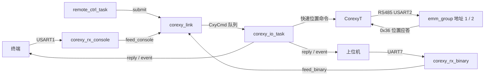

# CoreXY 逻辑梳理

> 目的：给后续重构提供结构视图。原理与踩坑细节见 `plan/CoreXY模块层方案.md`、`plan/CoreXY要点与避坑.md`，本文只写“有哪些东西、怎么串起来”。

## 1. 分层与文件

| 层 | 文件 | 职责 |
| --- | --- | --- |
| Module | `module/corexy.hpp/.cpp` | `CorexyT<Group>`：世界坐标 → 两台脉冲、双矩形限位、45°+轴向分段、状态机；**只发快速位置帧** |
| Module | `module/corexy_link.hpp/.cpp` | 三源入口（终端 / 二进制 / 遥控）、源仲裁、命令队列、按源上报 |
| Module | `module/module_cfg.hpp/.cpp` | 实例 `corexy` 与 `corexy_link`，以及 `module_init()` |
| App | `app/task/corexy_rx_console.cpp` | 终端口收字节 → `feed_console()` |
| App | `app/task/corexy_rx_binary.cpp` | 二进制口收字节 → `feed_binary()` |
| App | `app/task/corexy_io_task.cpp` | 独占电机总线：执行队列命令、推状态机、上报 |
| App | `app/task/remote_ctrl_task.cpp` | 遥控占位：采样后 `submit(CxyCmd)` |

依赖方向：`App → Module → Device(emm_group) → Bsp`。

## 2. 数据流

- **同一时刻只有一个源有效**（`corexy_link.select()`）：命令带 `from` 字段，非活动源 `submit()` 直接拒绝。
- 非活动口的字节仍由各自任务读走丢弃（不解析），防止接收缓冲溢出。
- 切源或活动源超时（`cxy_link::CMD_TIMEOUT_MS`，0 = 关闭）由 `corexy_io_task` 执行 `stop()`。
- `corexy_io_task` 是这条 485 总线**唯一**的接收消费者（`emm_group.update()` 在它里面）。

## 3. 任务时序

`corexy_io_task`：

1. `sys_state.wait_running()` → 延时 500 ms
2. `zero_here()` → `enable(true)` → 30 × `update(10 ms)`（复核原点）
3. 上报 BOOT（`origin_verified()` 决定 status）
4. 循环：清空队列执行命令 → `update(10 ms)` → 状态变化时上报 `DONE` / `FAULT`

## 4. `CorexyT` 接口与状态机

状态：`Idle`（可接新目标）/ `Moving`（走分段）/ `Fault`（越界、发送失败；只能 `stop()` 清）。

| 接口 | 要点 |
| --- | --- |
| `init()` | 只校验配置（地址、限位包含关系、rpm、tol），不发命令 |
| `enable(bool)` | 静默 `BUS_GAP_MS` 后逐台发使能/失能 |
| `zero_here()` | 广播停止 + 两台清零，世界原点 = 当前位置；之后由 `update()` 复核 |
| `move_to(Point)` / `move_by(Point)` | 安全限位校验 → 拆段 → 逐段下发 → 等到位才发下一段 |
| `stop()` | 逐台 + 广播共三帧，清 Fault |
| `set_speed(rpm, acc)` | 运行期可改；下一段自动重发 `0xF1` 参数 |
| `update(timeout_ms)` | 收字节、读两台 `0x36`、推进状态机；必须同一任务调用 |
| 查询 | `state / position / target / arrived / origin_verified / raw_counts / segment_index / segment_count / limits_theory / limits_safe` |

`move_to()` 拆段规则：

- `dx == 0`、`dy == 0` 或 `|dx| == |dy|` → 单段；
- 否则先 45° 段（`min(|dx|,|dy|)`），再走剩余轴向段（`0,0 → 100,50` 会先到 `50,50`）；
- 起点用当前**实测**坐标，不用上次指令值。

每段下发：`_send_segment()` **逐台**先发 `0xF1` 参数（rpm/acc 变化时）再发 `0xFC` 增量，`rpm_i = rpm·|Δp_i| / max|Δp|`，两台按比例同时到达。

到位判定（不依赖驱动器到位帧）：两台 `0x36` 读回都落在 `arrive_tol` 内，且相邻两次读回变化 ≤ `STILL_COUNTS`，连续 `ARRIVE_CONFIRM` 拍成立即到位。

## 5. 关键常量

| 常量 | 值 | 说明 |
| --- | --- | --- |
| `BUS_GAP_MS` | 2 ms | 半双工帧间静默 |
| `REPLY_TIMEOUT_MS` | 30 ms | 单台位置应答等待上限 |
| `SEG_DONE_MS` | 3000 ms | 段超时：先停；误差在窗口内算到位，否则补发一次，仍不行进 Fault |
| `STILL_COUNTS` | 10 | 约 0.006 mm，判“停稳” |
| `OVERRUN_MM` | 2.0 mm | 段内超行程判碰撞停机 |
| `ARRIVE_CONFIRM` / `ZERO_CONFIRM` | 2 / 2 | 连续确认拍数 |
| `ZERO_TOL_MM` | 0.5 mm | 原点复核窗口 |
| 几何（私有） | 40 mm/圈、3200 脉冲/圈、65536 counts/圈 | 80 脉冲/mm、1638.4 counts/mm |

## 6. 协议

帧：`A5 5A | CMD | LEN | PAYLOAD | SUM`，`SUM = CMD ^ LEN ^ 各负载字节`。

| CMD | 含义 | 负载 |
| --- | --- | --- |
| 0x01 | 使能 | `[1/0]` |
| 0x02 / 0x03 | 绝对 / 相对移动 | `[x:i16][y:i16]`（0.01 mm） |
| 0x04 / 0x05 | 清零 / 停止 | — |
| 0x06 | 速度 | `[rpm:u16][acc:u8]` |
| 0x07 | 快速位置参数 | `[addr][rpm:u16][acc:u8][mode]` |
| 0x08 | 快速位置 | `[addr][pulses:i32]` |
| 0x09 | 查询限位 | — |

应答 `CMD|0x80`（负载 `[status][x][y]`，限位为 `[status][理论4×i16][安全4×i16]`）；事件 `0x7F`（`[evt][status][x][y]`，evt：`BOOT/DONE/FAULT`）。

> 二进制帧**格式待定**（当前沿用 `A5 5A` 帧）；改协议只动 `corexy_link.cpp` 的 `parse_binary_frame()` / `reply()` / `event()`。

终端命令：`m x y`、`j dx dy`、`g 0..7 [mm]`、`pos`、`lim`、`home`、`stop`、`dump`、`en 0|1`、`spd rpm acc`、`qp addr rel|abs rpm acc`、`q addr pulses`、`src 0|1|2`（切源）。

终端与二进制的上电默认开关、默认源、超时都在 `module/corexy_link.hpp` 的 `cxy_link` 命名空间；
三个源的启用状态可在运行期用 `corexy_link.set_enabled(source, on)` 改（app 层直接调，关掉活动源会自动退回 `None` 并在 io 任务里停机）。

## 7. 剩余耦合

1. `QuickParam` / `QuickPos` 直接调 `emm_group`，绕过 `CorexyT`（保留作单台诊断帧）。
2. `emm_group.update()` 仍在 `corexy_io_task` 里（这条总线只允许一个消费者）。
3. 上电流程（zero → enable → 30 次复核）写死在任务里，不可配。
4. 几何比例是 `CorexyT` 私有常量，换驱动器必须改源码。
5. 二进制帧格式未定稿；`select()` 目前只能由终端 `src` 或 app 调用切换。
